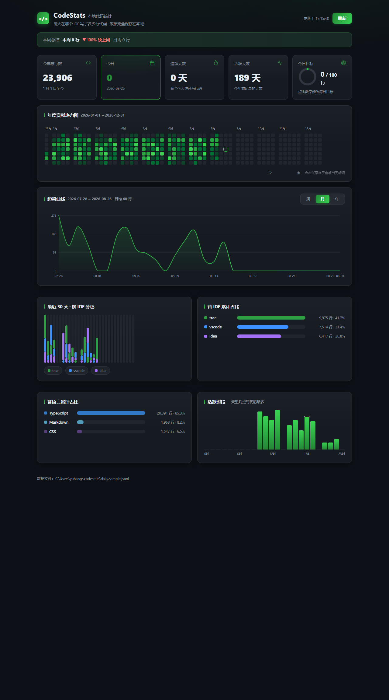

# CodeStats

本地代码统计工具：记录每天在哪个 IDE 写了多少行代码，提供 GitHub 风格的贡献热力图仪表盘。
数据完全保存在本地 `~/.codestats/daily.jsonl`，无服务器、无上传。

## 效果



## 功能

- 年度贡献热力图：自然年对齐、按月分隔，点击任意一天查看当天 IDE 与文件明细
- 趋势曲线：平滑曲线，支持周 / 月 / 年切换
- 按 IDE 分色统计：Trae（绿）、VSCode（蓝）、IntelliJ（紫）等
- 语言统计：按文件扩展名聚合
- 活跃时段：一天 24 小时的行数分布
- 每日目标环、每周总结（含环比）
- IDE 侧边栏：VSCode / IntelliJ IDEA 内直接查看，无需打开浏览器

## 支持的 IDE

| IDE | 方式 | 数据标识 |
| --- | --- | --- |
| Trae / VSCode / Cursor / Windsurf | 同一个 VSCode 扩展，自动识别 | `trae` / `vscode` / `cursor` / `windsurf` |
| IntelliJ IDEA | 独立 Kotlin 插件（`intellij/`） | `idea` |

所有 IDE 写入同一份 JSONL，仪表盘自动合并。

## 使用

### 预览（样例数据）

```bash
npm run preview     # 生成 365 天样例数据并启动仪表盘
# 打开 http://127.0.0.1:4399
```

### VSCode / Trae / Cursor / Windsurf

1. 扩展面板 → `...` → 从 VSIX 安装 → 选择 `extension/codestats-vscode-0.1.0.vsix`
2. 重启 IDE，正常写代码即可

开发调试：打开 `extension/` 文件夹按 F5。

安装后左侧活动栏出现 CodeStats 图标，点开即内嵌仪表盘。状态栏显示今日行数。

### IntelliJ IDEA

1. `Settings → Plugins → 齿轮 → Install Plugin from Disk` → 选择 `intellij/build/distributions/codestats-idea-0.1.0.zip`
2. 重启 IDEA，右侧 CodeStats 侧边栏显示完整仪表盘

自行构建：用 IDEA 打开 `intellij/` 文件夹（Gradle 项目），运行 `buildPlugin` 任务。
`gradle.properties` 中的 `intellijLocalPath` 指向本机 IDEA，留空则自动下载 SDK。

### 查看真实数据

```bash
npm start           # 读取 ~/.codestats/daily.jsonl
```

## 数据格式

`~/.codestats/daily.jsonl`，每行一条 JSON：

```json
{ "date": "2026-08-14", "ide": "trae", "file": "src/components/Header.tsx", "lines": 42, "ts": 1786600000000 }
```

| 字段 | 说明 |
| --- | --- |
| `date` | 本地时区日期（YYYY-MM-DD） |
| `ide` | trae / vscode / cursor / windsurf / idea |
| `file` | 文件路径 |
| `lines` | 本次聚合的新增行数 |
| `ts` | 落盘时间戳 |

统计口径：只统计插入的换行数。回车、粘贴多行、格式化新增行计入；单行内修改与删除不计。

## 架构

```
Trae / VSCode / Cursor / Windsurf  ── VSCode 扩展 ──┐
                                                    ├──> ~/.codestats/daily.jsonl
IntelliJ IDEA ── Kotlin 插件（intellij/）───────────┘            │
                                                                 ▼
                                        本地仪表盘（node dashboard/server.js）
                                        浏览器 / IDE 侧边栏（JCEF / Webview）
```

VSCode 系 IDE 共用一个扩展，通过 `vscode.env.appName` 自动识别，无需为每个 IDE 单独开发。

## 技术栈

| 模块 | 技术 | 依赖 |
| --- | --- | --- |
| VSCode 扩展 | 纯 JS + VS Code API | 无第三方依赖 |
| IDEA 插件 | Kotlin + IntelliJ Platform | 无第三方依赖 |
| 仪表盘 | 原生 Node http + 原生 JS + 手写 SVG | 无 npm 包 |
| 存储 | JSONL 追加写入 | 无 |

## 测试

```bash
node tools/test-dashboard.js          # 仪表盘 API 35 项
node tools/test-extension-logic.js    # 扩展逻辑 30 项
```

覆盖数据交叉校验、非法输入、空数据、脏数据容错，以及「编辑 → 聚合 → 落盘 → 仪表盘解析」全链路格式兼容。

## 目录结构

```
codestats/
├─ extension/              VSCode 系 IDE 扩展
│  ├─ extension.js         入口（VSCode API + 侧边栏 Webview）
│  ├─ lib.js               纯逻辑（IDE 识别 / 行数 / 记录格式）
│  ├─ stats.js             聚合统计（浏览器版与侧边栏共用）
│  ├─ webview/             前端（浏览器与 IDE 侧边栏共用）
│  ├─ media/               图标
│  └─ codestats-vscode-0.1.0.vsix
├─ intellij/               IntelliJ IDEA 插件（Kotlin + Gradle）
│  └─ src/main/kotlin/...  文档监听 / 聚合 / 落盘 / 侧边栏
├─ dashboard/
│  └─ server.js            本地服务器（静态服务 + /api/stats + /api/day）
├─ tools/                  样例数据生成器与测试
└─ package.json            npm start / npm run preview
```

## 已知限制

- 行数为插入的换行数，不含单行修改与删除
- 日期按本地时区切分
- `ts` 为落盘时刻而非编辑时刻，活跃时段为近似分布
- IDEA 插件适配 IDEA 系列；WebStorm / PyCharm 理论上可用，未逐一验证

## 许可

MIT License
