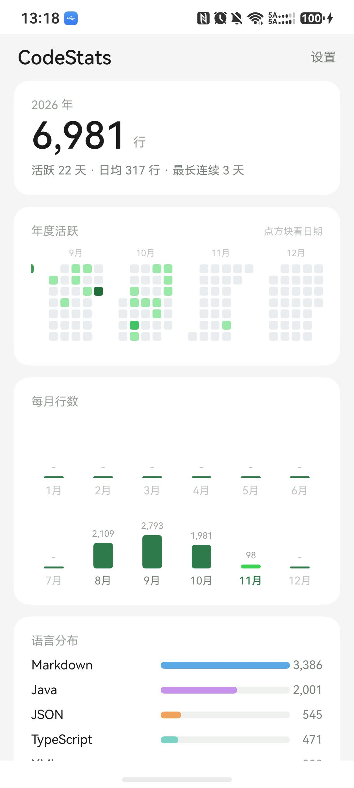

# CodeStats

本地代码统计工具：记录每天在哪个 IDE 写了多少行代码，提供 GitHub 风格的贡献热力图仪表盘，外加手机桌面卡片和年度看板。

原始数据始终保存在本地 `~/.codestats/daily.jsonl`。手机看板需要跨网络传输，才通过一个**私有 Gist** 中转——它只是一个 1.4 KB 的 JSON 文件，不含源码、不碰任何仓库。

## 效果

本地仪表盘：


鸿蒙 App（年度页）：



## 组成

| 部分 | 位置 | 作用 |
| --- | --- | --- |
| IDE 采集 | `extension/`、`intellij/` | 记录每次编辑新增的行数，追加到本地 JSONL |
| 本地仪表盘 | `dashboard/` | 浏览器 / IDE 侧边栏查看热力图与趋势 |
| 手机看板 | `harmony/` | 鸿蒙服务卡片（2×4）+ 年度统计 App |

## 功能

- 年度贡献热力图：自然年对齐、按月分隔，点击任意一天查看当天 IDE 与文件明细
- 趋势曲线：平滑曲线，支持周 / 月 / 年切换
- 按 IDE 分色统计：Trae（绿）、VSCode（蓝）、IntelliJ（紫）等
- 语言统计：按文件扩展名聚合
- 活跃时段：一天 24 小时的行数分布
- 每日目标环、每周总结（含环比）
- IDE 侧边栏：VSCode / IntelliJ IDEA 内直接查看，无需打开浏览器
- 鸿蒙桌面卡片：本月热力格 + 今日 / 本月 / 本年行数 + 本月语言分布，点卡片直接进 App
- 鸿蒙 App：全年总览、按月分块的热力图（左右滑动、点方块看当天行数）、月度柱状图、语言与 IDE 分布
- 深浅色跟随系统：颜色全部走 `resources/dark` 限定符，切换主题时 App 和卡片一起变

## 支持的 IDE

| IDE | 方式 | 数据标识 |
| --- | --- | --- |
| Trae / VSCode / Cursor / Windsurf | 同一个 VSCode 扩展，自动识别 | `trae` / `vscode` / `cursor` / `windsurf` |
| IntelliJ IDEA | 独立 Kotlin 插件（`intellij/`） | `idea` |

所有 IDE 写入同一份 JSONL，仪表盘自动合并。

## 使用

### 预览（样例数据）

```bash
npm run preview     # 生成 365 天样例数据并启动仪表盘
# 打开 http://127.0.0.1:4399
```

### VSCode / Trae / Cursor / Windsurf

1. 扩展面板 → `...` → 从 VSIX 安装 → 选择 `extension/codestats-vscode-0.1.0.vsix`
2. 重启 IDE，正常写代码即可

开发调试：打开 `extension/` 文件夹按 F5。

安装后左侧活动栏出现 CodeStats 图标，点开即内嵌仪表盘。状态栏显示今日行数。

### IntelliJ IDEA

1. `Settings → Plugins → 齿轮 → Install Plugin from Disk` → 选择 `intellij/build/distributions/codestats-idea-0.1.0.zip`
2. 重启 IDEA，右侧 CodeStats 侧边栏显示完整仪表盘

自行构建：用 IDEA 打开 `intellij/` 文件夹（Gradle 项目），运行 `buildPlugin` 任务。
`gradle.properties` 中的 `intellijLocalPath` 指向本机 IDEA，留空则自动下载 SDK。

### 查看真实数据

```bash
npm start           # 读取 ~/.codestats/daily.jsonl
```

## 手机看板

手机不在同一个局域网时，需要一台中转。这里用**私有 Gist** 当键值存储，零成本、无需服务器。
只用到 `gist` 一个权限，读不到任何代码仓库。

```
PC  tools/sync-gist.js ──PATCH──▶ 私有 Gist: codestats.json (1.4 KB)
                                        │
手机 App / 桌面卡片     ──GET────▶ 渲染
```

### 1. 配置

在 GitHub 生成 token（`Settings → Developer settings → Personal access tokens`，只勾 **gist**），写入：

```json
// ~/.codestats/sync.json
{ "token": "ghp_xxx", "gistId": "" }
```

首次运行会自动建一个私有 Gist 并回填 `gistId`：

```bash
npm run sync
```

### 2. 定时同步（Windows 任务计划）

不要直接用 `node.exe` 当任务动作——它会在桌面上闪一个黑色控制台窗口。
用 `tools/codestats-sync.exe`（源码 `tools/launcher.cpp`，GUI 子系统 + `CREATE_NO_WINDOW`）：

```bat
schtasks /Create /SC MINUTE /MO 15 /TN "CodeStatsSync" /F ^
  /TR "C:\path\to\codestats\tools\codestats-sync.exe"
```

改了项目路径就重新编译：

```bash
cd tools && g++ -O2 -mwindows -o codestats-sync.exe launcher.cpp
```

删除任务：`schtasks /Delete /TN "CodeStatsSync" /F`

### 3. 编译安装 App

用 DevEco Studio 打开 `harmony/`，`File → Project Structure → Signing Configs` 勾选自动签名（需华为账号实名），
然后命令行安装：

```bash
hvigorw assembleHap --mode module -p product=default
hdc install -r entry/build/default/outputs/default/entry-default-signed.hap
```

App 里填 token 和 gistId（gistId 在电脑上跑 `npm run sync` 时会打印），点「立即同步」。
桌面长按 → 服务卡片 → CodeStats → 拖 2×4 卡片。

细节与踩坑记录见 [harmony/README.md](harmony/README.md)。

### 4. 图标

图标由 `tools/make_icon.py` 生成（纯标准库，不依赖 PIL）：

```bash
python tools/make_icon.py
```

改配色改脚本顶部的 `BG` / `DARK` / `MID` / `HI`，改疏密改 `CELL` / `GAP` / `RADIUS` 比例。

## 数据格式

`~/.codestats/daily.jsonl`，每行一条 JSON：

```json
{ "date": "2026-08-14", "ide": "trae", "file": "src/components/Header.tsx", "lines": 42, "ts": 1786600000000 }
```

| 字段 | 说明 |
| --- | --- |
| `date` | 本地时区日期（YYYY-MM-DD） |
| `ide` | trae / vscode / cursor / windsurf / idea |
| `file` | 文件路径 |
| `lines` | 本次聚合的新增行数 |
| `ts` | 落盘时间戳 |

统计口径：只统计插入的换行数。回车、粘贴多行、格式化新增行计入；单行内修改与删除不计。

同步到 Gist 的聚合结果（v4）包含：当月热力格、年度热力格（按周切列、只铺到本周）、12 个月汇总、
年度语言分布、年度 IDE 分布、活跃天数 / 日均 / 最长连续。字段说明见 `harmony/README.md`。

## 架构

```
Trae / VSCode / Cursor / Windsurf  ── VSCode 扩展 ──┐
                                                    ├──> ~/.codestats/daily.jsonl
IntelliJ IDEA ── Kotlin 插件（intellij/）───────────┘            │
                                                                 ├──▶ 本地仪表盘（node dashboard/server.js）
                                                                 │    浏览器 / IDE 侧边栏（JCEF / Webview）
                                                                 │
                                                                 └──▶ sync-gist.js ──▶ 私有 Gist
                                                                                          │
                                                                        鸿蒙卡片 / App ◀───┘
```

VSCode 系 IDE 共用一个扩展，通过 `vscode.env.appName` 自动识别，无需为每个 IDE 单独开发。

## 技术栈

| 模块 | 技术 | 依赖 |
| --- | --- | --- |
| VSCode 扩展 | 纯 JS + VS Code API | 无第三方依赖 |
| IDEA 插件 | Kotlin + IntelliJ Platform | 无第三方依赖 |
| 仪表盘 | 原生 Node http + 原生 JS + 手写 SVG | 无 npm 包 |
| 鸿蒙 App / 卡片 | ArkTS + ArkUI（API 22） | 无第三方依赖 |
| 同步脚本 | Node（内置 fetch） | 无 |
| 存储 | JSONL 追加写入 + 私有 Gist | 无 |

## 测试

```bash
node tools/test-dashboard.js          # 仪表盘 API 35 项
node tools/test-extension-logic.js    # 扩展逻辑 30 项
```

覆盖数据交叉校验、非法输入、空数据、脏数据容错，以及「编辑 → 聚合 → 落盘 → 仪表盘解析」全链路格式兼容。

## 目录结构

```
codestats/
├─ extension/              VSCode 系 IDE 扩展
│  ├─ extension.js         入口（VSCode API + 侧边栏 Webview）
│  ├─ lib.js               纯逻辑（IDE 识别 / 行数 / 记录格式）
│  ├─ stats.js             聚合统计（浏览器版与侧边栏共用）
│  ├─ webview/             前端（浏览器与 IDE 侧边栏共用）
│  ├─ media/               图标
│  └─ codestats-vscode-0.1.0.vsix
├─ intellij/               IntelliJ IDEA 插件（Kotlin + Gradle）
├─ dashboard/
│  └─ server.js            本地服务器（静态服务 + /api/stats + /api/day）
├─ harmony/                鸿蒙工程（卡片 + App）
│  ├─ entry/src/main/ets/widget/pages/WidgetCard.ets   2×4 卡片
│  ├─ entry/src/main/ets/pages/Index.ets               年度主页
│  ├─ entry/src/main/ets/pages/Settings.ets            设置页
│  ├─ entry/src/main/ets/common/Sync.ets               Gist 拉取 / 缓存 / 推卡片
│  ├─ entry/src/main/ets/common/Grid.ets               网格切分 + 配色 + 千分位
│  └─ entry/src/main/resources/{base,dark}/element/color.json   深浅色
├─ tools/
│  ├─ sync-gist.js         聚合本地数据并推送到 Gist
│  ├─ launcher.cpp         无窗口启动器（给计划任务用）
│  ├─ make_icon.py         生成鸿蒙分层图标
│  ├─ simulate.js          样例数据生成
│  └─ test-*.js            自动化测试
└─ package.json            npm start / npm run sync / npm run preview
```

## 已知限制

- 行数为插入的换行数，不含单行修改与删除
- 日期按本地时区切分
- `ts` 为落盘时刻而非编辑时刻，活跃时段为近似分布
- IDEA 插件适配 IDEA 系列；WebStorm / PyCharm 理论上可用，未逐一验证
- 手机看板依赖电脑开机：定时任务只在这台机器上跑，关机期间数据不更新（也不会丢，开机后补推）
- 换一台电脑写代码，新机器的记录不会进入这个系统
- Gist 会保留每次修改的版本历史（每 15 分钟一次），存在 GitHub 侧，不占本地空间

## 许可

MIT License
